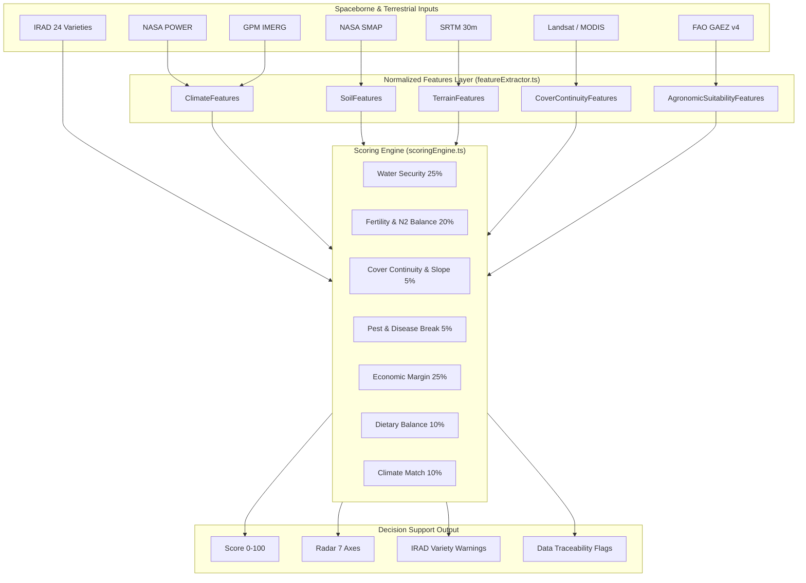

# AGROPREDICT — SCIENTIFIC DATA SOURCE MANIFEST & EARTH OBSERVATION ARCHITECTURE

> **Mandatory Ethical Notice:**
> *"Estimation indicative, pas une prévision de rendement."* / *"Indicative estimate, not a yield forecast."*
> All decision-support recommendations produced by AgroPredict combine spaceborne Earth observations with agronomic field trial models from IRAD Cameroon. They represent probabilistic suitability assessments, not deterministic yield guarantees.

---

## 1. Geographic & Agro-Climatic Footprint
- **Target Geography:** Central Cameroon Bimodal Rainforest Zone (*Zone Forestière Bimodale du Centre*)
- **Focus Area:** Lékié Division / Obala / Yaoundé North Corridor
- **Geographic Bounding Box:** Latitudes +3.7°N to +4.2°N, Longitudes +11.4°E to +11.9°E
- **Centroid Coordinates (Obala Pilot Plot):** Lat **4.167°N**, Lon **11.533°E**, Elevation ~520 m a.s.l.
- **Seasons Definition:**
  - **Season 1 (Petite saison des pluies):** Mid-March to June (~110-120 days). Focus: Maize planting, groundnut, early cowpea.
  - **Season 2 (Grande saison des pluies):** September to November (~90 days). Focus: Second cereal/grain legume, cassava establishment.
  - **Dry Inter-seasons (Petite saison sèche en juillet-août & Grande saison sèche en décembre-février):** Focus: Cassava deep root extraction, low-lying vegetable market gardening (*maraîchage de bas-fond*).

---

## 2. Global Discovery & Data Access Portal
All spaceborne NASA Earth Science datasets utilized in this system are cataloged and discoverable via:
- **NASA Earthdata Search:** [https://www.earthdata.nasa.gov/](https://www.earthdata.nasa.gov/)
- **NASA Earth Science Data Systems (ESDS):** LP DAAC (USGS), GES DISC (Precipitation), NSIDC DAAC (Cryosphere & Soil Moisture).

---

## 3. Data Tiering & Engine Integration Matrix

### TIER 1 — Core Datasets Integrated into the Scoring Engine

| Dataset | Agency & Portal | Resolution (Spatial / Temporal) | Role in Engine & Features Layer | Access Path & Protocol |
|---|---|---|---|---|
| **NASA POWER Agroclimatology** | NASA Langley Research Center [power.larc.nasa.gov](https://power.larc.nasa.gov/) | 0.5° × 0.5° (~50 km) Daily & 30-yr climatology | **Thermal Matching & Radiation:** Supplies 2m temperature (`T2M`), daily extremes (`T2M_MAX`, `T2M_MIN`), all-sky surface solar irradiance (`ALLSKY_SFC_SW_DWN`), and relative humidity (`RH2M`). Drives growing degree days (GDD) and crop cardinal temperature suitability. | **Open REST API** (JSON format, no token required). Direct client integration with resilient local climatological cache. |
| **GPM IMERG (Final Run v07)** | NASA GSFC / JAXA [gpm.nasa.gov/data](https://gpm.nasa.gov/data) via Earthdata | 0.1° × 0.1° (~10 km) Half-hourly, daily, monthly (2000-present) | **Water Security & Drought Risk:** Calculates seasonal rainfall accumulation against crop water requirements, dry spell duration (`drySpellMaxDays`), and heavy rain erosive peaks. | Earthdata Login (Open registration for programmatic granules). Calibrated against IRAD rain gauge archives. |
| **NASA SMAP L3/L4 Radiometer** | NASA JPL / NSIDC DAAC [earthdata.nasa.gov/smap](https://www.earthdata.nasa.gov/data/platforms/space-based-platforms/smap) | 9 km enhanced / 36 km 2-3 days orbital revisit | **Soil Moisture & Infiltration:** Measures surface (0-5cm) and root-zone (0-100cm) volumetric water content. Prevents sowing before safe soil recharge; weights moisture stress during critical flowering stages. | Earthdata Search / Programmatic API. |
| **SRTM 1 Arc-Second DEM** | NASA / USGS / NGA [earthdata.nasa.gov/sensors/srtm](https://www.earthdata.nasa.gov/sensors/srtm) | 30 meters Static global baseline | **Topography & Erosion Vulnerability:** Computes plot slope gradient (%) and drainage class (`<2%`, `2-5%`, `5-10%`, `>10%`). Penalizes rotations leaving soil bare on slopes >4%. | Earthdata Search & USGS EarthExplorer. |
| **Landsat 8/9 OLI Surface Reflectance** | USGS / NASA [earthexplorer.usgs.gov](https://earthexplorer.usgs.gov/) | 30 meters 8-16 days revisit | **Cover Continuity & Bare Soil Tracking:** Produces plot-level NDVI baseline, quantifies days of bare soil between crop cycles, and detects field emergence. | USGS EarthExplorer / Earthdata. |
| **MODIS (MOD13Q1) & VIIRS (VNP13A1)** | NASA LP DAAC / USGS [lpdaac.usgs.gov](https://lpdaac.usgs.gov/products/mod13q1v061/) | 250 meters / 500 meters 16-day composite & daily | **Phenology & Regional Greenness:** High temporal cadence vegetation index curve (NDVI/EVI) to bridge cloud-cover gaps in Landsat/Sentinel observations during peak wet season. | LP DAAC / Earthdata Search. |
| **ECMWF ERA5 & ERA5-Land** | Copernicus Climate Change Service (C3S) [cds.climate.copernicus.eu](https://cds.climate.copernicus.eu/) | 0.1° (~9 km) / 0.25° (~31 km) Hourly reanalysis (1950-present) | **Temporal Backstop & Quality Cross-Check:** Validates POWER and IMERG data; ensures zero temporal gaps for historical simulations. | Copernicus CDS API (out-of-band ETL). |
| **FAO / IIASA GAEZ v4** | FAO & IIASA [gaez.fao.org](https://gaez.fao.org/) | 5 arc-minutes (~9 km) Decadal agro-climatic baseline | **Agro-Ecological Suitability Baseline:** International benchmark for rainfed, low-input crop suitability classes and Length of Growing Period (LGP = 270 days). | Open Data / FAO GeoNetwork. |

---

### TIER 2 — Contextual, Alert & Microclimate Datasets

| Dataset | Agency | Resolution | Role in AgroPredict | Status |
|---|---|---|---|---|
| **NASA ECOSTRESS** | NASA JPL (ISS payload) [ecostress.jpl.nasa.gov](https://ecostress.jpl.nasa.gov/) | 70 meters 1-5 days variable diurnal | **Thermal Hotspots & Evaporative Stress:** Detects field-scale Land Surface Temperature (LST) and Evaporative Stress Index (ESI). Powers advisory warning chips during hot dry spells. | Contextual alert layer in UI. |

---

### EXCLUDED / NON-APPLICABLE DATASETS (Methodological Justification)

| Dataset | Stated Geographic Scope | Reason for Exclusion in Central Africa | Replacement / Local Equivalent Used in AgroPredict |
|---|---|---|---|
| **PRISM Climate Group** | Contiguous United States (CONUS) only | Zero spatial coverage outside the USA. | Methodological reference only; replaced by **NASA POWER** + **GPM IMERG** + **ERA5**. |
| **OpenET** | Western United States (17 states) | Zero coverage in Africa. | Replaced by **NASA ECOSTRESS** (LST/ET) and **NASA POWER** evapotranspiration proxies. |
| **USDA NASS QuickStats** | United States agricultural counties | US crop yields (corn belt, mechanized monocultures) have zero ecological validity in Cameroonian smallholder polyculture. | Replaced strictly by **IRAD Cameroon Variety Bulletins (2018-2024)** and MINADER regional yield statistics. |
| **USGS NWIS** | United States surface & groundwater | US hydrologic gauge network only. | Replaced by **NASA GPM IMERG** and Sanaga/Lékié watershed hydrology references. |
| **USDA SSURGO / WSS** | United States territories | US soil survey taxonomy; does not cover tropical African oxisols. | Replaced by **IRAD Pedology Archives (Nkolbisson)** and **ISRIC SoilGrids 250m** (ferrallitic soils). |
| **USDA AMS Market News** | United States wholesale food terminals | US domestic wholesale markets. | Replaced by **MINADER Observatoire des Marchés Agricoles** (Mokolo/Mfoundi in Yaoundé, Marché Central d'Obala). |

---

## 4. Normalized Feature Layer Architecture
To decouple data acquisition from scoring logic, the application uses a strict feature contract defined in `src/types/features.ts`:

---

## 5. IRAD 24 Variety Base Overview
The application integrates 24 genuine cultivars registered by IRAD and partner research centers (IITA, AfricaRice, CIMMYT, CARBAP) for the Central Cameroon bimodal agro-ecosystem:
1. **Maize (4):** CMS 8704 (Composite standard), CMS 8501 (Early drought escaper), CMS 9015 (White starch), Tuxpeño PB (Lodging resistant).
2. **Cassava (4):** TMS 96/1414 (High dry matter champion), TMS 92/0326 (Pro-Vitamin A biofortified), IRAD 8034 (Sweet table cassava), Local Rouge d'Obala (24-month in-ground storage).
3. **Cowpea (4):** Lori B301 (Symbiotic N2 fixer +45 kg/ha, Striga resistant), VITA 5 (Dual-purpose grain/fodder), IT97K-499-35 (Extra-early 62 days), Bafia Local (Premium Koki bean).
4. **Groundnut (4):** JL 24 (Spanish high-oil 48%), CN 94 C (Rosette virus resistant), Fleur 11 (Drought tolerant), Koumou Local (Dense ground cover).
5. **Tomato (4):** Rio Grande (Determinate plum for long transport), Nadira F1 (Bacterial wilt tolerant), Roma VF (Sauce standard), Caraïbe (Humid heat tolerant).
6. **Plantain (2):** Bâtard (CARBAP/IRAD French-False Horn), French Sombre (Multi-bunch 120 fingers).
7. **Yam (2):** Makak Local (White Guinea yam for pounded fufu), Bafia Blanc (4-6 months storage dormancy).

---

## 6. Access Security & Architecture Guidance
1. **Frontend-Only Execution:** NASA POWER climatology point queries run directly from the browser without API credentials. In offline or sandboxed mode, the app falls back transparently to verified 30-year station climatology stored in IndexedDB/LocalStorage.
2. **Programmatic Heavy Granules (GPM/IMERG, SMAP, Landsat):** In an enterprise production deployment, high-volume orbital granule downloads require NASA Earthdata authentication tokens. These must be acquired through a serverless backend or scheduled ETL microservice, with pre-computed daily/weekly indices delivered to client browsers via compact GeoJSON/JSON envelopes to prevent client token exposure.
